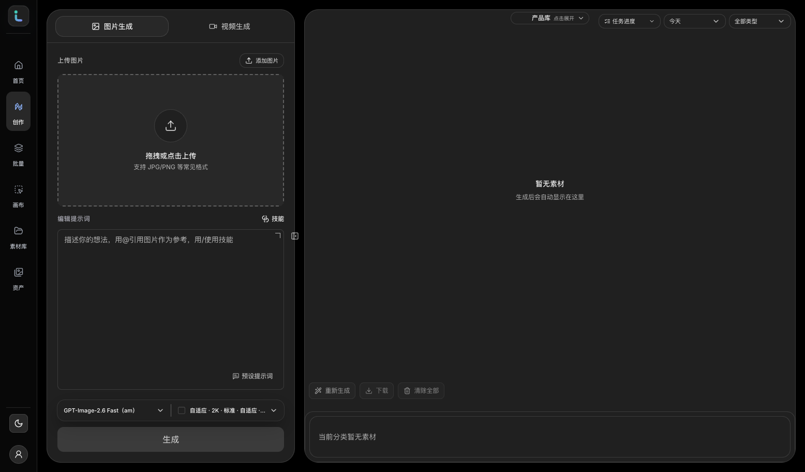
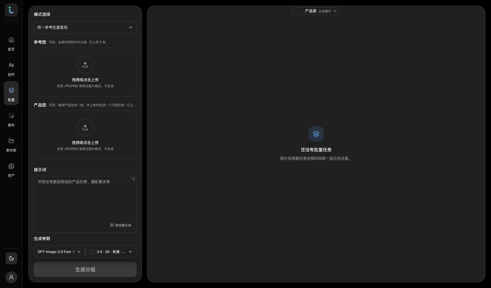
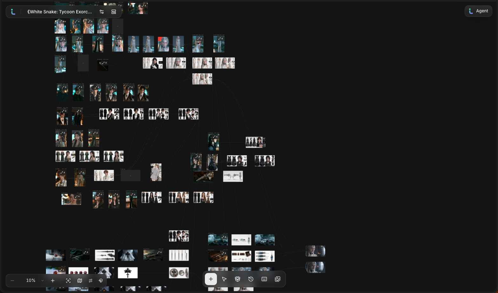
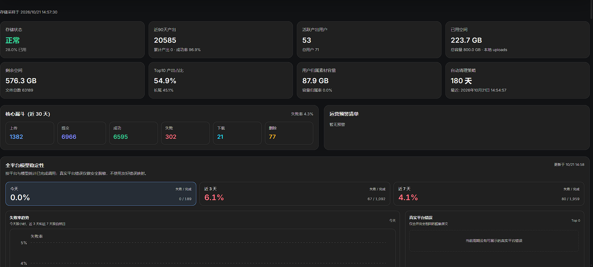
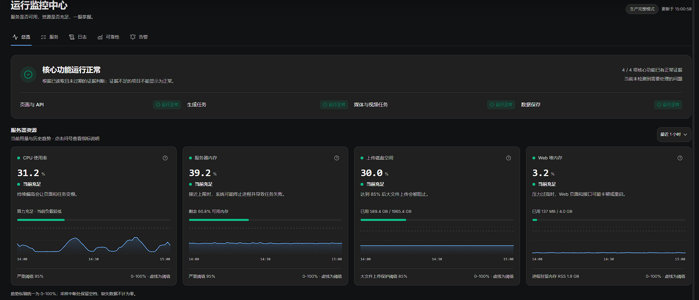

<div align="center">


<p>
  
  
  
  
  
</p>

**Inkvia 是免费开源的 AI 图像与视频创作平台：部署在公司内网，团队多人共用，管理员统一管理模型、费用和数据。**<br />
<sub>Self-hosted AI image &amp; video studio for teams · LAN deployment · centralized admin</sub>

<p>
  <a href="#deploy">下载并安装</a> ·
  <a href="#usage">使用说明</a> ·
  <a href="#faq">常见问题</a>
</p>

</div>

---

## 1. 🌟 亮点

| 能力 | 说明 |
| --- | --- |
| 🏢 **团队共用** | 装在一台机器上，局域网里的同事打开浏览器就能用，每人一个账号。 |
| 🔐 **管理员统一管理** | API Key 只在后台配置，员工看不到；用量、费用、成功率一目了然。 |
| 🖼️ **图片 / 视频生成** | 上传参考图、`@` 引用素材、`/` 调用技能，多种模型随时切换。 |
| 📦 **批量出图** | 一组参考图批量出多张场景图；一段需求自动拆成多组，分别生成。 |
| 🧭 **无限画布** | 角色、场景、道具、视频在一张画布上连线管理，内置 Agent 辅助。 |
| 🗂️ **资产与素材库** | 个人作品自动归档，团队素材共享，产品图集中管理。 |
| 🏠 **数据在自己手里** | 作品和记录都存在你自己的机器上，请求直连你选择的模型平台。 |

**常见问题速览**

**Inkvia 是什么？** 一个自己部署的 AI 图像与视频创作平台，适合公司、工作室、设计团队在内网多人使用。

**免费吗？** MIT 开源，可以免费部署和修改；调用模型平台的费用由你直接付给各平台。

**支持哪些模型？** GPT-Image、Nano Banana、Seedream、Seedance、通义万相、MiniMax 等，详见下面的[支持的模型平台](#providers)。

**适合多少人用？** 我们自己公司在内网用它做电商图、产品图和短视频，几十位同事日常使用，累计生成两万多张图片和视频。

---

## 2. 📸 功能看点

### 看点 1｜创作：图片生成与视频生成



- 上传参考图，在提示词里用 `@图片1` 引用；输入 `/` 调用技能。
- 内置预设提示词，常用写法一键套用。
- 切换模型、比例、分辨率、数量；视频支持参考图、参考视频、参考音频。
- 生成记录自动保留，可以重新生成、下载、对比。

### 看点 2｜批量：一次出一整组



- **统一参考批量复刻**：同一组参考图，批量生成多张不同场景。
- **自定义分批**：一段需求自动拆成多组提示词，每组单独出图、单独下载。
- 也支持批量生成视频。

### 看点 3｜画布：把整个项目铺开来做



- 无限画布，图片、视频、文本节点自由连线，一个项目的所有素材放在一起。
- 内置 Agent：帮你规划镜头、写提示词、批量生成。
- 视频工具：读视频、读音频、拉片分析、去字幕。

### 看点 4｜资产与素材库

- **资产**：自己生成过的图片、视频、音频按日期整理，可筛选、批量下载。
- **素材库**：团队共享的参考素材，按分类筛选，生成时直接挑来用。
- **产品库**：常用产品图集中管理，在创作和批量里一键引用。
- 首页**灵感发现**：展示精选作品，给团队找灵感。

### 看点 5｜管理后台：管理员的控制台



- **系统概览**：产出数量、成功率、存储用量、流程漏斗、运营预警。
- **系统监控**：服务状态、CPU / 内存 / 磁盘用量、日志、告警。
- **用户管理**：每个人的生成记录、资产、画布、预设、技能和费用账单，支持导出。
- **系统设置**：模型平台与 API Key、员工可见的模型、价格规则、参考素材发送方式、产品库、素材库、预设提示词、技能、公告和教程。
- **反馈中心 / 操作日志**：员工反馈和关键操作都有记录。



---

<a id="providers"></a>

## 3. 🔌 支持的模型平台

在后台填入对应平台的 API Key 即可使用，用哪家填哪家：

| 平台 | 主要能力 |
| --- | --- |
| KIE.AI、APIMart | 图片、视频（GPT-Image、Nano Banana、Seedance 等） |
| 火山引擎 | Seedream 图片、Seedance 视频、视频理解、语音、去字幕 |
| 阿里云百炼 | 通义万相视频、Qwen 图片与理解 |
| MiniMax | 图片、视频、多模态理解 |
| Google AI Studio | Nano Banana 图片 |
| OpenRouter、智谱、DeepSeek | 文本与多模态理解（提示词、Agent） |

<sub>以上名称和商标归各自所有者所有。Inkvia 是独立的开源项目，与这些平台没有合作或从属关系，仅说明可以对接它们的公开 API。</sub>

---

<a id="deploy"></a>

## 4. 🚀 下载并安装

Inkvia 有两种用法：

| 用法 | 适合 | 怎么装 |
| --- | --- | --- |
| **桌面客户端** | 个人使用，装在自己电脑上 | 下载安装包，双击安装，开箱即用 |
| **服务器部署** | 公司、工作室，局域网多人共用 | 装在一台常开的机器上，同事用浏览器访问 |

### 4.1 桌面客户端（Windows / macOS）

点击文件名直接下载（当前版本 v0.1.0，历史版本见 [Releases 页面](https://github.com/psdll/Inkvia/releases)）：

| 系统 | 安装包 | 要求 |
| --- | --- | --- |
| Windows | [⬇️ Inkvia-0.1.0-win-x64-setup.exe](https://github.com/psdll/Inkvia/releases/download/v0.1.0/Inkvia-0.1.0-win-x64-setup.exe) | Windows 10 / 11（64 位） |
| macOS | [⬇️ Inkvia-0.1.0-mac-arm64.dmg](https://github.com/psdll/Inkvia/releases/download/v0.1.0/Inkvia-0.1.0-mac-arm64.dmg) | Apple 芯片（M1 及以后） |

- **Windows**：双击 `.exe` 安装。如果弹出"Windows 已保护你的电脑"，点"更多信息"→"仍要运行"。第一次安装时如果电脑缺少微软 VC++ 运行库，安装程序会自动装上。
- **macOS**：打开 `.dmg`，把 Inkvia 拖进"应用程序"。第一次打开如果提示"无法验证开发者"，到"系统设置 → 隐私与安全性"，点"仍要打开"。
- 客户端自带数据库，所有数据都保存在你自己的电脑上，不需要另外安装任何软件。
- 打开后在"设置 → 系统设置 → API 配置"填入模型平台的 API Key，就可以开始用。

> 安装包暂未做代码签名，所以系统会弹出上面的安全提示，按提示放行即可。

### 4.2 服务器部署（局域网多人使用）

装在公司里一台常开的机器上（下面称"服务器"），同事通过浏览器访问，**员工电脑不需要安装任何东西**。

#### 第 1 步：准备一台服务器

| 项目 | 建议 |
| --- | --- |
| 系统 | Linux（推荐 Ubuntu 22.04 / 24.04），macOS 也可以 |
| 配置 | 4 核 CPU、8 GB 内存以上；磁盘按作品量预留，建议 200 GB 起 |
| 网络 | 和员工电脑在同一局域网；能访问你要用的模型平台（必要时在后台配置代理） |
| 软件 | Node.js 22.12+（22 或 24 LTS）、PostgreSQL 16、FFmpeg（含 `ffprobe`）、Git |

#### 第 2 步：下载代码

```bash
git clone https://github.com/psdll/Inkvia.git Inkvia
cd Inkvia
npm ci
```

#### 第 3 步：配置数据库与数据目录

连接 PostgreSQL 的 `postgres` 数据库，以有创建角色和数据库权限的账号执行以下 SQL。把密码改成实际的独立随机值。先运行 `node -e 'console.log(require("node:crypto").randomUUID())'` 生成一个 UUID，填入下面的数据库标识。

```sql
CREATE ROLE inkvia LOGIN PASSWORD 'REPLACE_DATABASE_PASSWORD';
CREATE DATABASE inkvia OWNER inkvia;
ALTER DATABASE inkvia SET "inkvia.instance_id" TO 'REPLACE_WITH_DATABASE_UUID';
```

```bash
cp .env.example .env.local
chmod 600 .env.local
pwd -P
```

按 `.env.example` 的说明填写 `.env.local`。用 `pwd -P` 的输出填写 `APP_ROOT_DIR`，为 `INKVIA_DATA_DIR` 选择可写的独立绝对路径。`DATABASE_URL` 和 `INKVIA_DB_INSTANCE_ID` 使用前面创建的数据库、密码和标识。为 `ADMIN_PASSWORD` 和 `ADMIN_SECRET` 分别生成新的随机值，例如分别运行一次 `openssl rand -hex 32`。

在源码目录执行以下首次配置。它创建数据目录、写入数据库的安全隔离策略，并在密钥环不存在时生成用户密码加密密钥。

```bash
node <<'JS'
const fs = require('node:fs');
const path = require('node:path');
const { randomBytes } = require('node:crypto');
require('@next/env').loadEnvConfig(process.cwd());
const env = process.env;
const db = new URL(env.DATABASE_URL);
const directories = [env.UPLOADS_DIR, env.IMPORTS_DIR, env.EXPORTS_DIR];
for (const directory of directories) fs.mkdirSync(directory, { recursive: true, mode: 0o700 });
fs.mkdirSync(path.join(env.UPLOADS_DIR, '_thumbs'), { recursive: true, mode: 0o700 });
fs.writeFileSync(path.join(env.UPLOADS_DIR, '.inkvia-uploads'), 'INKVIA_UPLOADS_V1\n', { mode: 0o600 });
for (const file of [env.INKVIA_RUNTIME_POLICY, env.PASSWORD_CIPHER_KEYRING_FILE]) {
  fs.mkdirSync(path.dirname(file), { recursive: true, mode: 0o700 });
}
const policy = {
  schemaVersion: 1,
  profile: 'production',
  projectRoot: fs.realpathSync(env.APP_ROOT_DIR),
  database: {
    endpointId: `${db.hostname.toLowerCase()}:${db.port || '5432'}`,
    databaseName: decodeURIComponent(db.pathname.slice(1)),
    roleName: decodeURIComponent(db.username),
    instanceId: env.INKVIA_DB_INSTANCE_ID,
  },
  writableRoots: directories.map(directory => fs.realpathSync(directory)),
  networkMode: 'production',
  allowedTestOrigins: [],
};
fs.writeFileSync(env.INKVIA_RUNTIME_POLICY, JSON.stringify(policy, null, 2) + '\n', { mode: 0o600 });
try {
  fs.writeFileSync(env.PASSWORD_CIPHER_KEYRING_FILE, JSON.stringify({
    [env.PASSWORD_CIPHER_ACTIVE_KEY_ID]: randomBytes(32).toString('base64'),
  }) + '\n', { mode: 0o600, flag: 'wx' });
} catch (error) {
  if (error.code !== 'EEXIST') throw error;
}
JS
```

#### 第 4 步：初始化数据库并启动

```bash
npm run prisma:generate
node scripts/runtime-command.cjs production node_modules/prisma/build/index.js migrate deploy
node scripts/runtime-command.cjs production node_modules/prisma/build/index.js db execute --schema prisma/schema.prisma --file config/deploy/online-indexes/generation-request-key.sql
INKVIA_LOCAL_PRODUCTION=1 npm run build
INKVIA_LOCAL_PRODUCTION=1 npm run start
```

迁移和创建生成请求唯一索引的命令都会先校验数据库身份。网页服务默认监听 3000 端口。保留这个终端，再从同一源码目录启动 5 个后台任务进程。下面的命令可在同一终端后台运行，也可分别在 5 个终端前台运行，每个终端都需要先导出运行配置。

```bash
export INKVIA_RUNTIME_PROFILE=production NODE_ENV=production TSX_DISABLE_CACHE=1
npm run worker:image-batch &
npm run worker:canvas:generation &
npm run worker:canvas:media &
npm run worker:live-video:prompt &
npm run worker:live-video:video
```

正式使用时，建议用 systemd 或 PM2 把网页服务和这几个任务进程设为开机自启、崩溃自动重启。

#### 第 5 步：访问与数据说明

- 管理员打开 `http://服务器的内网IP:3000/admin`，用 `.env.local` 中配置的账号和密码登录，在「系统设置 → 账号与权限 → 账号与用户名分配」添加员工的用户名。员工随后打开 `http://服务器的内网IP:3000`，用该用户名注册普通账号。
- 在服务器运行 `curl -fsS http://127.0.0.1:3000/api/health/readiness`，检查返回的 `ready` 为 `true`。
- 只在公司内网使用时，不要把 3000 端口开放到公网。
- **所有数据都在服务器上**：PostgreSQL 保存账号和记录，`INKVIA_DATA_DIR` 保存素材、导入导出文件和密钥环。定期备份数据库、整个数据目录和 `.env.local`。
- 升级时退出网页和任务进程，保留数据库、数据目录及配置。更新源码后重新执行 `npm ci` 和第 4 步。

---

<a id="usage"></a>

## 5. 📖 使用说明

**管理员（第一次）**

1. 用 `.env.local` 里设置的管理员账号和密码登录后台。
2. 在"系统设置 → API 配置"填入要用的平台 API Key，勾选对员工开放的模型。
3. 在"系统设置 → 账号与权限 → 账号与用户名分配"添加员工的用户名，只有添加过的用户名才能注册。
4. 按需设置模型价格、参考素材发送方式、产品库和素材库。
5. 把访问地址和各自的用户名发给同事。

**员工**

1. 浏览器打开公司内网地址，用管理员给你的用户名注册账号，自己设置密码。
2. 在"创作"里选模型、写提示词、上传参考图，点"生成"。
3. 一次要出很多张，用"批量"；做完整项目（比如一部短剧的角色和场景），用"画布"。
4. 生成的东西都在"资产"里，随时可以下载。

---

<a id="faq"></a>

## 6. ❓ 常见问题

**公司网络访问不了国外模型平台？** 在后台"系统设置"里配置代理，只对需要的平台生效。

**花费怎么算？** 费用由你直接付给各模型平台。Inkvia 后台按你设置的价格规则记录每个人的用量，方便内部核算。

**API Key 谁能看到？**
- **服务器部署（网页版）**：Key 由管理员在后台统一配置，只保存在服务器上，员工看不到，也改不了。
- **桌面客户端**：Key 是你自己填的，只存在你自己的电脑上，你自己可以查看和修改。

---

## 7. 📜 开源许可

Inkvia 采用 [MIT 许可证](LICENSE)。第三方依赖遵循各自的许可与版权声明。

<div align="center">

Copyright © 2026 Inkvia

</div>
